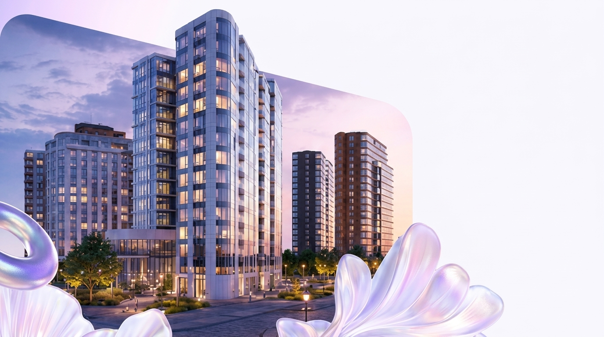
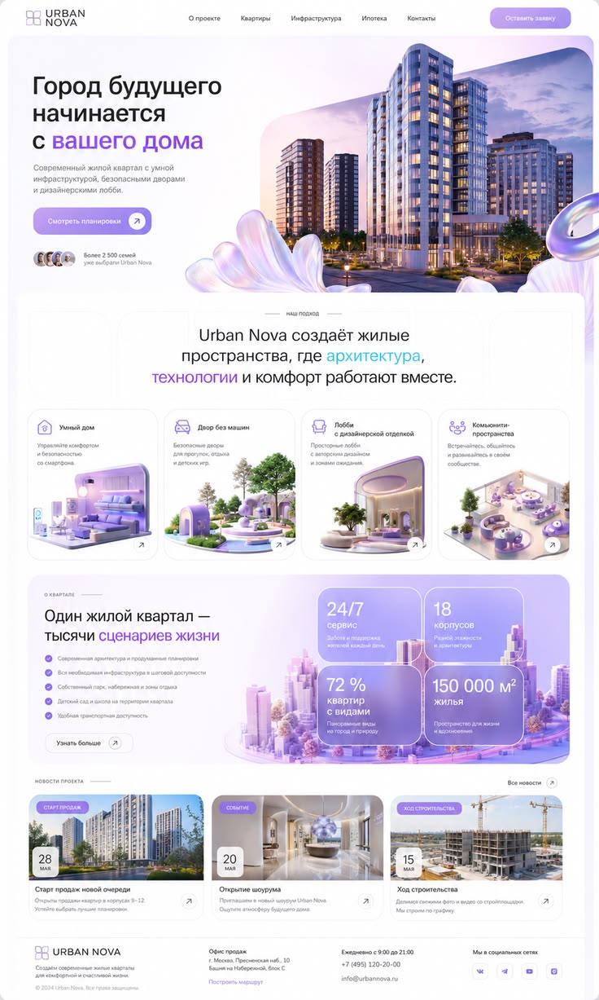
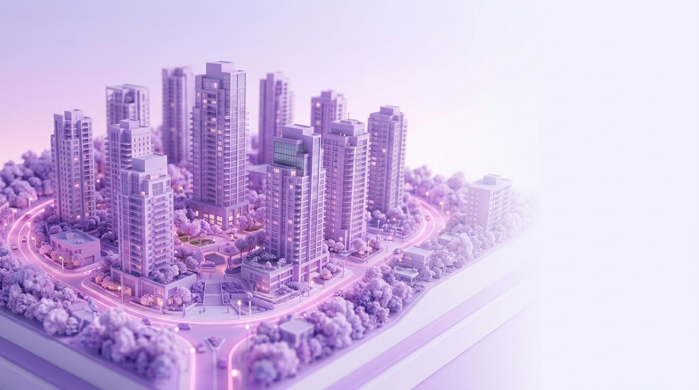
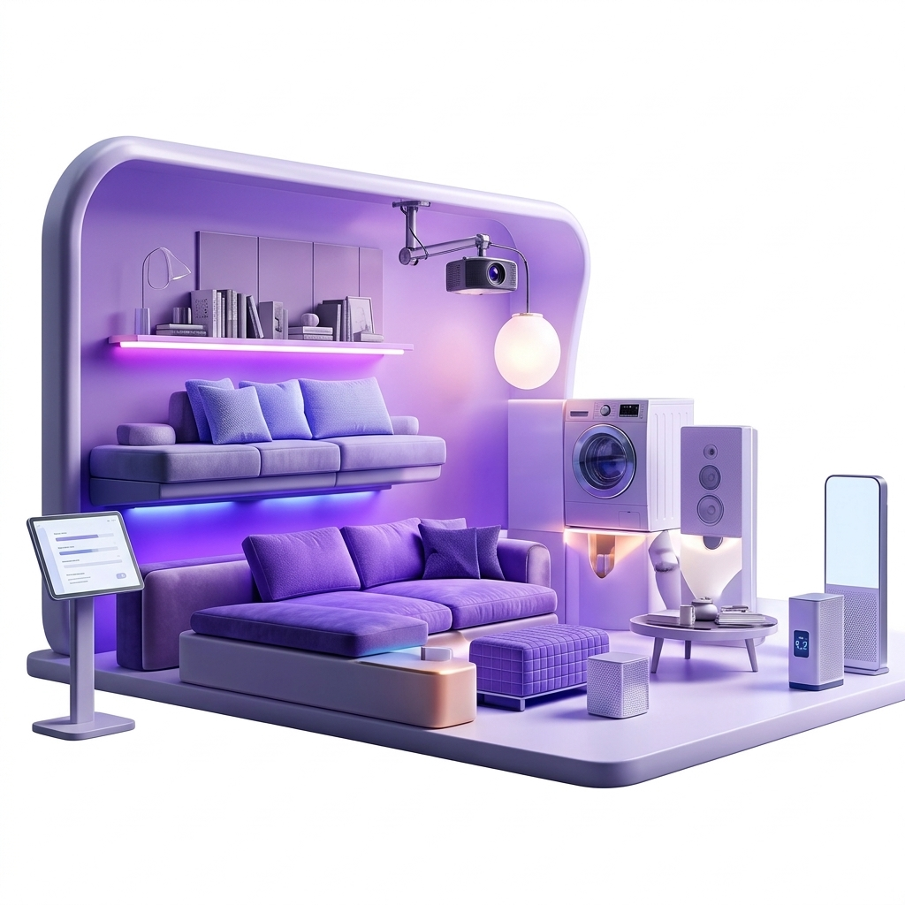
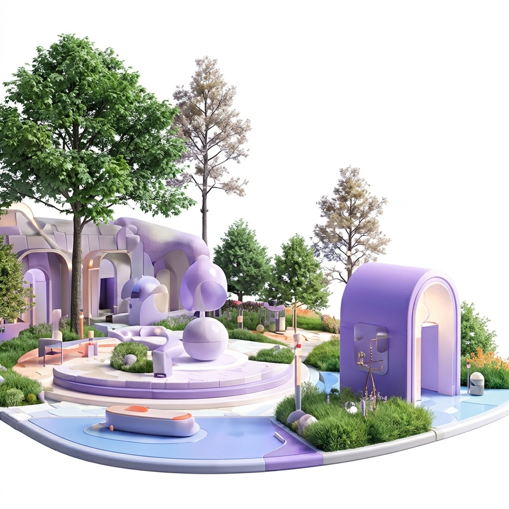
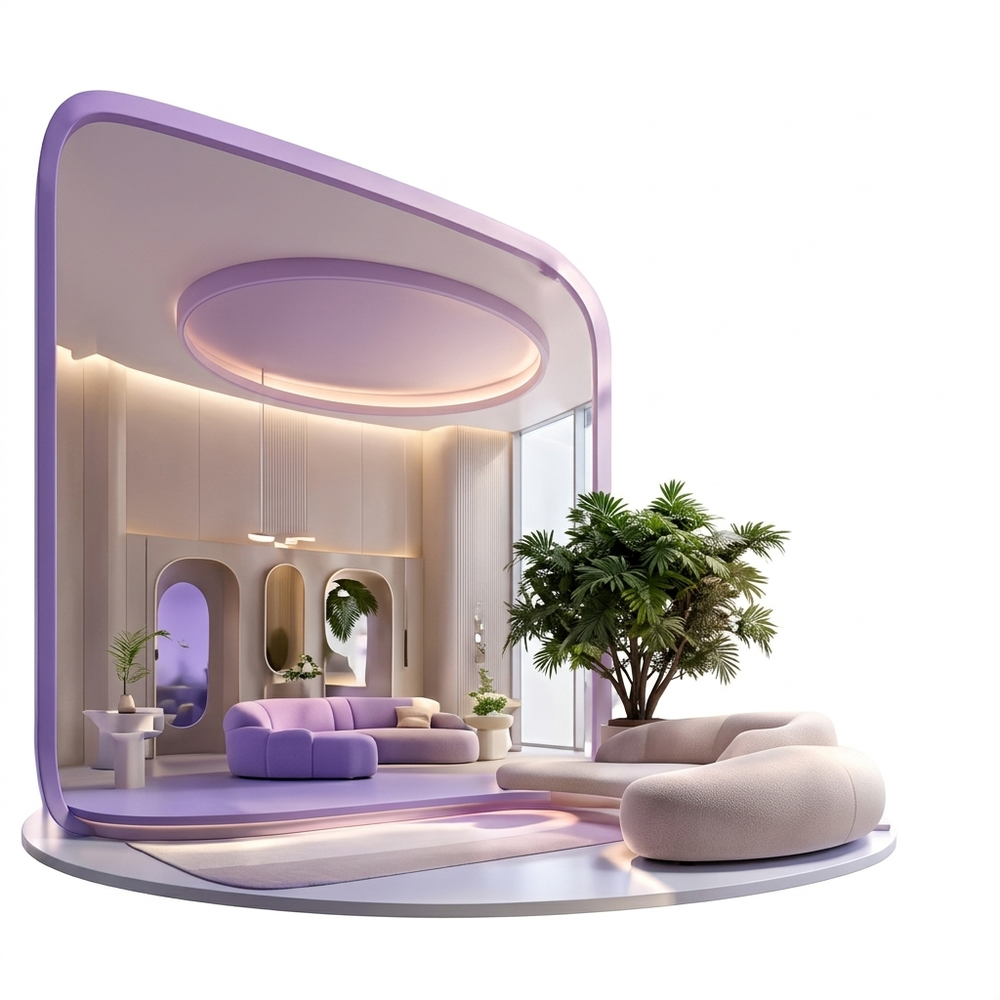
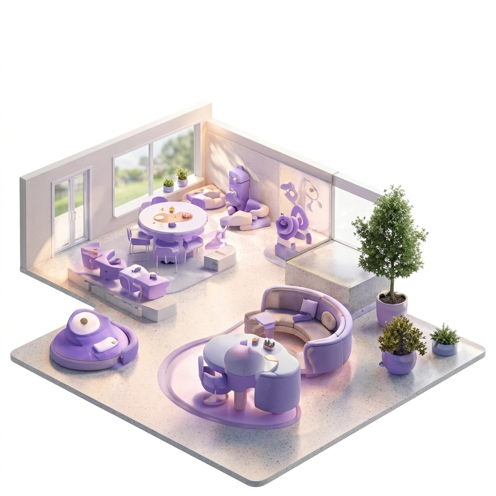
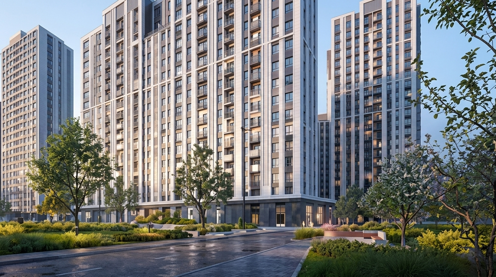
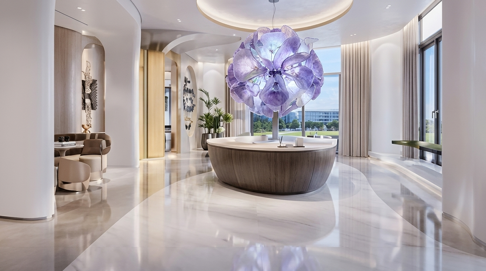
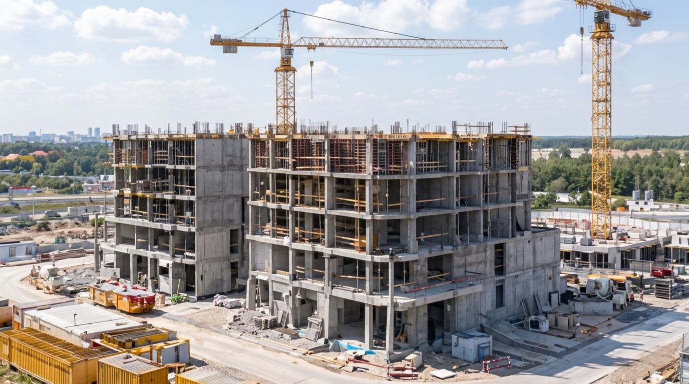

# Urban Nova — أوربان نوفا | الحي السكني العصري للمستقبل

<div align="center">
  
</div>

<br />

تطبيق ويب عقاري متكامل باللغة العربية (**RTL**) لمشروع **Urban Nova (أوربان نوفا)** السكني، مصمم ليحاكي الهوية البصرية، الألوان، التايبوغرافي، والرسوم المعمارية ثلاثية الأبعاد للتصميم المرجعي بدقة **4K Ultra-HD** مع استجابة كاملة على جميع الشاشات (الهواتف، الأجهزة اللوحية، والشاشات العريضة).

A full-screen, responsive Arabic (**RTL**) real estate web application for **Urban Nova**, crafted to match the visual language, pastel-lavender palette, typography, and 3D isometric illustrations of the visual reference in **4K Ultra-HD**.

---

## التصميم المرجعي والواجهات البصرية | Visual Reference & 4K Assets

### 1. التصميم المرجعي الأصلي (Reference Design)
<div align="center">
  
</div>

---

### 2. الواجهة الرئيسية ومجسم الحي السكني (4K RTL Hero & Quarter Banners)

| قسم الواجهة الرئيسية (Hero Section - 4K RTL) | قسم عن الحي السكني (About the Quarter - 4K RTL) |
| :---: | :---: |
|  |  |

---

### 3. منهجيتنا — الرسوم ثلاثية الأبعاد (4K Isometric 3D Illustrations)

| المنزل الذكي (Smart Home) | ساحة بلا سيارات (Car-Free Courtyard) | ردهات بتصميم فاخر (Designer Lobby) | مساحات مجتمعية (Community Spaces) |
| :---: | :---: | :---: | :---: |
|  |  |  |  |

---

### 4. أخبار المشروع (4K Project News Photography)

| انطلاق مبيعات المرحلة الجديدة | افتتاح صالة العرض | تطورات الأعمال الإنشائية |
| :---: | :---: | :---: |
|  |  |  |

---

## المميزات الرئيسية | Key Features

1. **دعم كامل للغة العربية واتجاه RTL (`dir="rtl" lang="ar"`)**:
   - تنسيق تايبوغرافي احترافي يجمع بين خط **Cairo** للنصوص العربية وخط **Plus Jakarta Sans** للأرقام والرموز اللاتينية (`tabular-nums`).
2. **قسم الواجهة الرئيسية المتجاوب (Responsive Hero Section)**:
   - فصل ذكي بين عمود النصوص والأزرار على اليمين ومنطقة الرسوم المعمارية ثلاثية الأبعاد على اليسار لمنع أي تداخل على شاشات التابلت والجوال والشاشات المكتبية، مع تباين أزرار قياسي (**WCAG AA+**).
3. **مستكشف المخططات السكنية التفاعلي (Interactive Floor Plan Explorer)**:
   - تصفية فورية للشقق حسب الفئة (`جميع الشقق`، `استوديو`، `غرفة وصالة`، `غرفتين وصالة`، `3 غرف وصالة`).
   - تأثير تلاشي تدريجي (**Fade-in Hover Effect**) عند تمرير المؤشر على بطاقات المخططات السكنية.
   - مخطط هندسي تفاعلي يعرض توزيع الغرف والمساحات مع إمكانية التبديل بين أنماط التشطيب الثلاثة (`اسكندنافي فاتح`، `عصري دافئ`، `نيو-كلاسيك فاخر`).
4. **ميزة مقارنة شقتين جنباً إلى جنب (Side-by-Side Apartment Comparison)**:
   - اختيار أي شقتين من قائمة **«اختر تخطيط شقتك المثالية»** وعرضهما جنباً إلى جنب في نافذة مقارنة تفاعلية توضح **فرق المساحة الإجمالية (م²)**، **فرق السعر الإجمالي (ر.س)**، **فرق القسط الشهري**، **سعر المتر المربع**، وتوزيع الغرف والمميزات الحصرية لكل شقة.
5. **حاسبة التمويل العقاري وخطط السداد (Mortgage & Payment Plan Calculator)**:
   - حساب فوري للقسط الشهري والدفعة الأولى مع دعم 3 أنظمة سداد: `تمويل عقاري (حتى 30 سنة)`، `أقساط مرحلية 0% فوائد`، و`دفع نقدي (خصم 6%)`.
6. **قسم أخبار المشروع التفاعلي (Project News Cards)**:
   - بطاقات أخبار مزودة بحركة ارتفاع ناعمة وظل عميق عند تمرير المؤشر (`hover`) مع نافذة قراءة تفصيلية لكل خبر.

---

## هيكل المشروع | Project Structure

```text
├── public/
│   └── assets/
│       └── aistudio/
│           └── image_4a903ae3.png         # الصورة المرجعية الأصلية للتصميم
├── src/
│   ├── assets/
│   │   └── images/                        # الصور والرسوم المعمارية بدقة 4K Ultra-HD
│   ├── components/
│   │   ├── ReferenceArtwork.tsx           # مكونات الشعار والأيقونات واللوحات الرسومية
│   │   ├── InteractiveFloorPlanDiagram.tsx# المخطط الهندسي التفاعلي للوحدات السكنية
│   │   └── InteractiveModals.tsx          # نوافذ المقارنة، المخططات، التمويل، وطلب الاستشارة
│   ├── data/
│   │   └── urbanNovaData.ts               # بيانات الشقق، المميزات، الإحصائيات، والأخبار
│   ├── App.tsx                            # الواجهة الرئيسية المتكاملة للتطبيق
│   ├── index.css                          # إعدادات Tailwind CSS والخطوط العربية
│   └── main.tsx                           # نقطة تشغيل تطبيق React
├── index.html
├── package.json
└── vite.config.ts
```

---

## التشغيل والتطوير | Getting Started

```bash
# تثبيت الحزم البرمجية | Install dependencies
npm install

# تشغيل خادم التطوير على المنفذ 3000 | Start development server
npm run dev

# بناء نسخة الإنتاج | Build for production
npm run build
```
